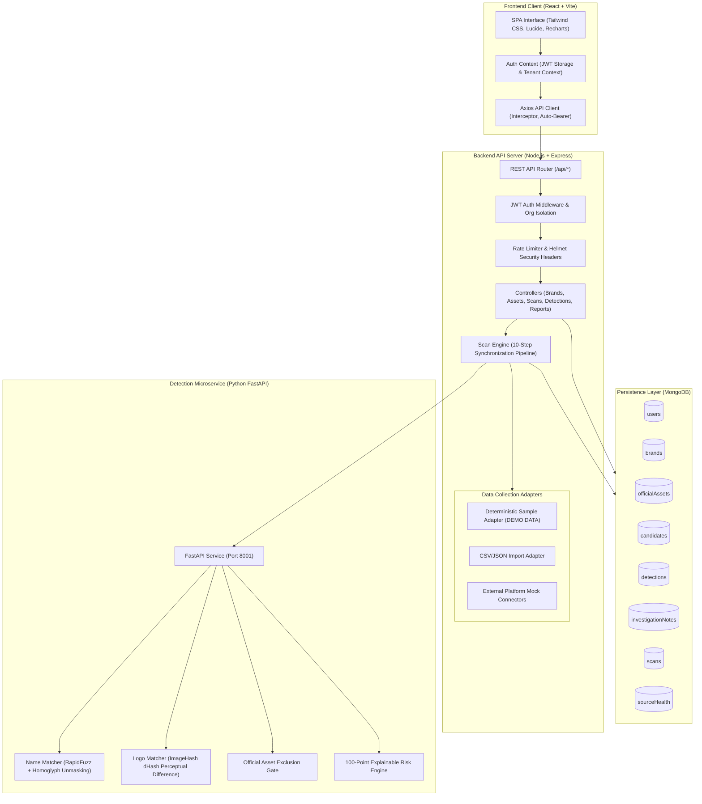

# BRANDTRACE System Architecture

> **Tagline:** Follow the Identity. Find the Risk.  
> **Category:** Digital Risk Protection — Social Profile & Mobile App Monitoring

---

## 1. Architectural Overview

BRANDTRACE is architected as an explainable, multi-tenant Digital Risk Protection (DRP) platform. It safeguards enterprise brand identities by continuously analyzing social media candidate profiles and mobile application listings against an auditable Official Asset Registry.

---

## 2. Core Subsystems

### A. Frontend Layer (React + Vite)
- **Role:** Interactive enterprise security console.
- **Key Modules:**
  - `DashboardPage`: Live KPI widgets, Recharts severity distribution, channel comparison, and real-time detection queue.
  - `BrandsPage`: Organization brand configuration, legal entity registration, logo uploads via Multer, and aliases.
  - `AssetsPage`: Official Asset Registry for trusted URLs, handles, domains, and package IDs.
  - `SocialMonitorPage` & `AppMonitorPage`: Filtered, paginated surveillance catalog.
  - `ScansPage`: Audit trail of all scan jobs with execution metrics.
  - `ThreatInvestigationPage`: Deep dive into flagged candidates with transparent signal point breakdowns and analyst notes.
  - `ReportsPage`: Formula injection safe CSV exports and printable briefings.

### B. Backend API Server (Node.js + Express ES Modules)
- **Role:** Multi-tenant coordinator, request validation, business logic, and database operations.
- **Security Features:**
  - **Organization Isolation:** Every query enforces `organization: req.user.organization`.
  - **Input Sanitization:** URL normalization, path traversal prevention for file uploads, and CSV formula escaping (`=, +, -, @`).
  - **Resilient Fallback:** An embedded JavaScript detection engine mirrors the Python microservice if the service is unreachable.

### C. Detection Engine (Python 3 + FastAPI)
- **Role:** High-speed string similarity, homoglyph normalization, perceptual logo comparison, and explainable risk scoring.
- **Components:**
  - `name_matcher.py`: RapidFuzz string metrics (token sort ratio, partial ratio) and homoglyph unmasking (`0 -> o`, `3 -> e`, `1 -> l`).
  - `logo_matcher.py`: 64-bit difference hash (`dhash`). Does not invent scores when hashes are absent.
  - `official_asset_checker.py`: Strict exclusion gate verifying exact registered URLs, social handles, or package IDs.
  - `risk_scorer.py`: Computes the 100-point composite score with categorization into Low, Medium, High, and Critical.

---

## 3. Data Collection Architecture

BRANDTRACE decouples data ingestion from detection using the `SourceAdapter` pattern:

| Adapter | Role | Status |
|---|---|---|
| **Deterministic Sample Adapter** | Ingests rich fictional fixtures (`sample-data/`) covering look-alikes, leetspeak variants, app impersonations, and exclusions. | Always Available |
| **CSV/JSON Import Adapter** | Parses analyst-provided external bulk exports with schema validation. | Available |
| **External Platform Adapters** | Interfaces for Twitter/X and App Store crawlers. Respects terms and platform policies by honestly reporting unconfigured states when tokens are missing. | Configurable / Fallback |

---

## 4. Multi-Tenant MongoDB Schemas

- **`users`**: Secure bcryptjs password hashes (`cost: 10`), analyst roles, and organization scope.
- **`brands`**: Enterprise brands with trademark aliases, keywords, and trusted domains.
- **`officialAssets`**: Whitelist of official profiles, domains, and apps. Indexed with `{ brandId: 1, assetType: 1, identifier: 1 }` for exact exclusion.
- **`candidates`**: Discovered social profiles and store listings.
- **`detections`**: Threat findings linking candidates to brands. Compound unique index `{ brandId: 1, candidateId: 1 }` prevents duplicate findings.
- **`investigationNotes`**: Immutable audit log of analyst actions, status changes, and justifications.
- **`scans`**: Execution history with candidate counts, exclusion counts, and duration telemetry.
- **`sourceHealth`**: Connectivity status of all data adapters.
